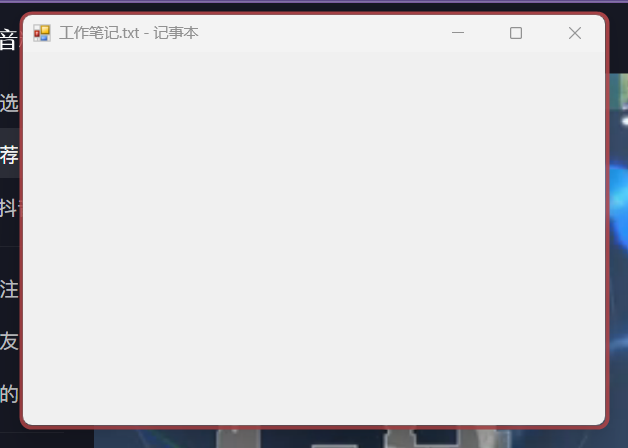
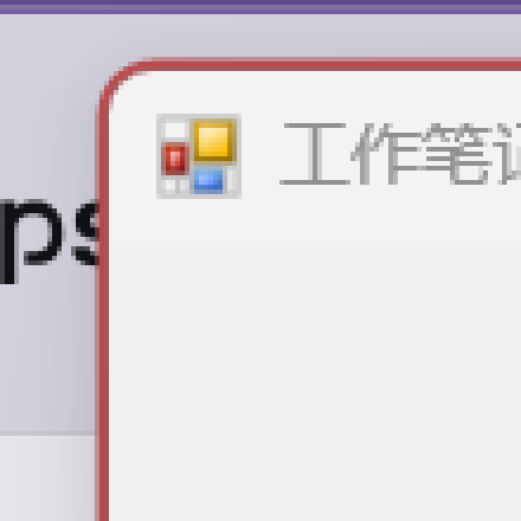

# AlwaysOnTop · 轻量窗口置顶

Windows 上的一个小工具：**按一下快捷键，把当前窗口钉在最前**，并用系统强调色的边框把"已置顶"标出来。

单文件 **166 KB**、绿色免安装、不写注册表、不装服务、不自启（可选）——如果你只想要 PowerToys 里的 Always on Top 这一个功能，又不想为此装一整套，这个就是给这种情况准备的。


| 置顶边框（强调色、贴窗口外沿） | 圆角贴合（6 倍放大） |
|---|---|
|  |  |

## 为什么再造一个

PowerToys 的 [Always on Top](https://learn.microsoft.com/windows/powertoys/always-on-top) 已经很好用，我用了很久。但它是整套 PowerToys 的一部分：要装几百 MB、跑常驻进程、带一堆模块。

我只需要那一个功能，于是读了它的实现（`WindowBorder.cpp` / `FrameDrawer.cpp`，MIT 许可），照着同样的思路写了个单文件版，并尽量在**观感上**对齐：同样的默认快捷键、同样的系统强调色、同样"窗口外沿长出一圈"的边框，而不是框在外面的另一个矩形。

## 功能

**核心**

- **快捷键置顶**：默认 `Win + Ctrl + T`，在设置里可改（必须带 Ctrl / Alt / Shift / Win 之一，或用 F1–F24）
- **强调色边框**：边框颜色取 Windows 系统强调色（`HKCU\...\DWM\ColorizationColor`），不是自选色，换主题时跟着变
- **边框粗细 3 / 4 / 5 px**、**不透明度 100 / 85 / 70 %**、**圆角跟随窗口系统圆角**（最大化窗口不加圆角）
- **拖动、缩放实时跟随**：拖动期间进入 5 ms 高频跟随模式并把系统计时器精度调到 1 ms，松手后自动退回
- **提示音**：置顶 / 取消置顶两种音高（内置合成，不需要音频文件）

**常驻与界面**

- **托盘常驻**：图标悬停显示当前快捷键，双击打开设置
- **关闭行为可配**：点 X 可以「收到托盘」继续后台待命（默认），也可以「退出程序」
- **置顶窗口列表**：列出当前所有置顶窗口，可单个或全部取消
- **单实例**：重复双击 exe 不会开第二个进程，而是把已有窗口叫到前台
- **开机自启**：只在启动文件夹放一个快捷方式，不写注册表

**自动维护**（不需要用户干预）

| 情况 | 程序怎么处理 |
|---|---|
| 置顶状态被别的程序清掉（某些启动器/游戏会这么干） | 窗口重新获得焦点时自动重新置顶 |
| 窗口最小化后还原 | 还原后重新置顶并重建边框 |
| 窗口被隐藏或已销毁 | 自动从置顶列表移除 |
| 窗口被拖到另一个虚拟桌面 | 不在当前桌面时不画边框，切回来自动补上 |
| 程序自己重启 | 扫描全部窗口，凡是仍带置顶标记的自动接管、重新挂边框 |
| 前台是全屏独占（D3D）程序 | 忽略快捷键，避免在游戏里误触（对齐 PowerToys 的 `blockInGameMode`） |

**权限自检**

- 启动时检查自己的完整性级别。如果继承到了低权限令牌（常见于从聊天工具里直接点开），页脚会红字提示并给出「以管理员身份重启」按钮——因为这种状态下**无法置顶其它程序**（详见下面第 1 个坑）。

## 快速开始

1. 下载 `AlwaysOnTop-便携版.zip`，**解压到普通文件夹**（不要直接在压缩包里双击运行，那样会继承低权限，置顶会失败）
2. 双击 `AlwaysOnTop.exe`
3. 点一下目标窗口让它在前台，按 `Win + Ctrl + T`
4. 托盘图标在任务栏 `^` 里，建议拖到任务栏常驻

系统要求：Windows 11（Windows 10 未实测，圆角会退化成直角）。需要 .NET Framework 4.x——Windows 自带，不用装。

更细的说明（托盘图标被 Win11 藏起来怎么找回来、配置项逐条解释、SmartScreen 成因、低权限报错怎么解）见 [使用说明.md](使用说明.md)。

## 已知限制

1. **拖动时边框仍可能慢半拍，最多 1 帧**（165 Hz 下约 6 ms，肉眼基本无感）。这是架构决定的：边框是一个独立的置顶分层窗口，和目标窗口是两次独立的合成提交，理论上压不到 0。PowerToys 结构一样，而且它是 100 ms 轮询，比这里慢得多。
2. 边框只对普通带边框窗口有意义；无边框窗口、全屏游戏里视觉上不明显。
3. 无法置顶**比本程序权限更高**的窗口（例如以管理员身份运行的程序），除非本程序也提权。
4. 没有排除列表、没有多语言、没有深色界面。

## 实现要点（想自己写一个的可以拿走）

这些都是踩过之后留下的结论，省得你再踩一遍。

**置顶本身**

- 就是 `SetWindowPos(hwnd, HWND_TOPMOST, 0,0,0,0, SWP_NOMOVE | SWP_NOSIZE)`，取消时传 `HWND_NOTOPMOST`。
- 一定要**检查返回值**，失败时 `GetLastError()` 通常是 `5`（拒绝访问），见下面第 1 个坑。
- 用 `SetProp(hwnd, "AlwaysOnTop_Pinned", 1)` 在窗口自己身上做标记。这个属性跨进程可读、随窗口存活，所以程序重启后能扫出"上次置顶过谁"并接管。

**边框窗口**

- 边框是一个**独立的置顶分层窗口**：`WS_POPUP | WS_DISABLED` + `WS_EX_LAYERED | WS_EX_TOPMOST | WS_EX_TOOLWINDOW | WS_EX_NOACTIVATE`，再用 `SetWindowPos(border, target, ..., SWP_NOMOVE|SWP_NOSIZE|SWP_NOACTIVATE)` 把它插到**目标窗口的下方**，于是它只露在窗口外沿，不挡内容。
- 矩形要取 `DWMWA_EXTENDED_FRAME_BOUNDS`，**不要用 `GetWindowRect`**：后者包含不可见的拖拽边距，Win10 以后两者会差几个像素，边框就会浮起来。
- 圆角同样从 DWM 读（`DWMWA_WINDOW_CORNER_PREFERENCE`），按 DPI 缩放；最大化窗口不加圆角。

**边框要画成"环"，不是"描边"**

- 内缩一个 `halfThickness + 1` 的 centerline（那 1 像素专门用来吃掉边框与窗口之间的缝），外圈半径 `r + halfThickness`、内圈半径 `max(r - halfThickness, 0)`，两个圆角矩形用 `FillMode.Alternate` 组成一个路径**一次填充**。
- 直接 `DrawPath` 描边 + `PenAlignment.Inset` 的效果是"框在外面"，而且内外圆角不同心，边角会露缝。

**抗锯齿边缘别用颜色键**

- `SetLayeredWindowAttributes` 抠黑色做透明，抗锯齿像素是往黑里混的，边缘会有一圈**暗边**。
- 正确做法是 per-pixel alpha：`Format32bppPArgb` 位图 + `UpdateLayeredWindow(..., ULW_ALPHA)` + `AC_SRC_ALPHA`，不透明度用 `BLENDFUNCTION.SourceConstantAlpha`。
- 注意换了这套渲染之后，**`Invalidate()` 就不再有意义了**——内容不再走 `WM_PAINT`，改参数必须重新提交一次 `UpdateLayeredWindow`（这个坑也踩过，表现为"改粗细没反应"）。

**跟随与自愈**

- `SetWinEventHook` 订 6 个事件：`EVENT_OBJECT_LOCATIONCHANGE`（移动）、`SYSTEM_MOVESIZESTART/END`（拖拽进出高频模式）、`OBJECT_FOCUS`（检查 topmost 是否被清掉，掉了就重新置顶）、`OBJECT_DESTROY`（目标没了就清）、`SYSTEM_MINIMIZESTART/END`（拆/重建边框）、`SYSTEM_FOREGROUND`。
- 空闲时把轮询降到 1 次/秒，有置顶窗口时才用 80 ms，拖动时 5 ms——省电且安静。

## 研发历程

完整版本记录见 [CHANGELOG.md](CHANGELOG.md)，这里只留结论性的几段。

**第一阶段：先把它跑起来。** 最初是一个单文件原型：注册全局热键、`SetWindowPos` 置顶、拉一个 `Form` 当边框。能用了，但边框是"框在窗口外面"的另一个矩形，而且移动时明显掉帧。

**第二阶段：去读 PowerToys。** 把 `WindowBorder.cpp`、`FrameDrawer.cpp` 和模块主体读完之后，才明白差在哪：它用独立的置顶分层窗口插到目标下方、用 `EXTENDED_FRAME_BOUNDS` 取矩形、用环带几何画边框、用 per-pixel alpha 合成。于是把这几件事逐条对照搬过来，包括那句注释写着原因的 `halfThickness + 1`。

**第三阶段：撞上 Windows 的三个硬坑。**

1. **完整性级别（UIPI）**：从聊天工具里双击 exe 运行时，进程继承到 Low 完整性令牌，`SetWindowPos` 跨进程直接返回 `5`。表现是"点了没反应"，而且没有任何报错。后来程序启动就自查完整性级别、失败时把错误码写进日志并在界面红字提示，最终用"解压后再运行"解决了使用侧的问题。
2. **低层鼠标钩子会冻结整机鼠标**：为了做"右键系统菜单里加一项"，用了 `WH_MOUSE_LL`，回调里又调了跨进程的**同步** `SendMessage`。只要目标进程一时不响应，回调不返回，整个鼠标输入队列就被挂住——用户看到的是"鼠标变成沙漏、整机卡住"。这个功能最后整个砍掉了（快捷键已经够用），教训是：**LL 钩子回调里不要做任何可能阻塞的事**。
3. **渲染换了内核，旧的刷新代码就成了空操作**：把 GDI+ 换成分层窗口逐像素 alpha 之后，设置里改粗细不再生效，因为代码还在调 `Invalidate()`，而新渲染根本不看 `WM_PAINT`。这类"改了一半的迁移"最难查，因为没有任何报错。

**第四阶段：按 PT 的清单补齐行为细节。** 把它的自愈逻辑摊开对照，补了 topmost 被清掉后重新置顶、最小化还原、窗口销毁清理、启动接管旧置顶、虚拟桌面感知、游戏模式拦截。这一批改动没有一条是"看得见的功能"，但正是它们让工具"用着不闹心"。

**第五阶段：把交互磨平。** 滑块换成 3/4/5 px 与 100/85/70% 的离散档位（并把"置顶中不可调"做成置灰，而不是让人对着没反应的滑块发愣）；关闭默认收到托盘；空载轮询降到 1 次/秒并在隐藏时压缩工作集。

一句话总结：**功能逻辑一天能写完，剩下的时间全花在"它为什么看起来不像原版"和"它为什么偶尔把系统搞卡"上。**

## 目录结构

```
AlwaysOnTop/
├─ AlwaysOnTop-便携版.zip   发布包（exe + 使用说明）
├─ 使用说明.md              面向使用者的完整说明
├─ CHANGELOG.md             版本与研发记录
├─ docs/                    README 用截图
└─ code/
   ├─ AlwaysOnTop.exe       编译产物
   ├─ Native.cs             P/Invoke 与常量
   ├─ Core.cs               设置、主题、边框窗口、控制器、事件钩子
   ├─ Ui.cs                 设置界面、托盘、入口、演示/自检模式
   ├─ AssemblyInfo.cs       版本与公司信息
   ├─ app.manifest          DPI 感知
   ├─ AlwaysOnTop.ico       图标
   ├─ make_icon.ps1         按配色重新生成图标
   └─ _legacy/              v1 单文件原型（留档）
```

## 从源码编译

没有 Visual Studio，也不需要——用系统自带的 C# 编译器即可（注意它只支持 **C# 5**：没有字符串插值、没有 `?.`、没有表达式体成员）：

```bat
csc /nologo /target:winexe /optimize+ ^
    /win32icon:AlwaysOnTop.ico /win32manifest:app.manifest ^
    /resource:AlwaysOnTop.ico,AlwaysOnTop.app.ico ^
    /out:AlwaysOnTop.exe ^
    /r:System.dll /r:System.Core.dll /r:System.Drawing.dll /r:System.Windows.Forms.dll ^
    AssemblyInfo.cs Native.cs Core.cs Ui.cs
```

编译器路径：`C:\Windows\Microsoft.NET\Framework64\v4.0.30319\csc.exe`

运行时自检与截图（开发时用，普通用户不需要）：

```bat
AlwaysOnTop.exe --selftest
AlwaysOnTop.exe --screenshot out.png
```

## 致谢

- [Microsoft PowerToys](https://github.com/microsoft/PowerToys)（MIT）：Always on Top 模块的实现思路、边框几何与刷新策略参考自它的 `WindowBorder.cpp` / `FrameDrawer.cpp`。本项目是独立重写的 C# 实现，未包含其源码。
- 图标与界面配色取自系统强调色与 `#64748B` 一族的灰蓝。

## 许可

[MIT](LICENSE) © 2026 jAm
